# ATLAS · FIRST SHIFT · Robotics & Automation Lab (VR)

An immersive VR training experience: a new trainee at the ATLAS robotics facility must verify six robot systems: joints, inverse kinematics, programming, grippers, safety and legged locomotion. ECHO, a holographic assistant, guides each step. Built in Unity 6 (URP, XR Interaction Toolkit 3) for Meta Quest, using NVIDIA SimReady robots rigged in Blender.

Full technical notes: [FIRST_SHIFT_README.md](FIRST_SHIFT_README.md)

---

## Quick start
1. Open the project in **Unity 6000.6.3f1**.
2. Press **Play** from any scene. **Robotics Lab ▸ Play Mode ▸ Always Start In Robotics Lab** loads `Assets/Robotics/Scenes/RoboticsLab.unity`.
3. **No headset?** The default mode, **XR Interaction Simulator**, gives mouse and keyboard control: hold the right mouse button to look, WASD to move, the left mouse button for trigger, G for grip.
   With a headset or the Meta XR Simulator, choose **Robotics Lab ▸ Play Mode ▸ Headset or Meta XR Simulator (OpenXR)**.
4. To rebuild the scene: **Robotics Lab ▸ Build Lab Scene**. Then bake the lighting: **Robotics Lab ▸ Lighting ▸ Bake (GPU, async)**.

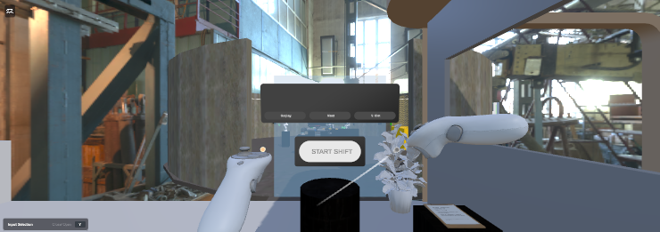

---

## The story
| Ch | Robot | Concept | Task |
|---|---|---|---|
| 01 | Universal Robots UR17g | Joints, DOF, forward kinematics | Jog joints to put the tool in the green sphere |
| 02 | Franka FR3 (7-DOF) | Inverse kinematics, redundancy | Drag the orange IK handle into the target |
| 03 | FANUC CRX-10iA | Waypoints and programming | Record 3 waypoints, Run, Home |
| 04 | Robotiq 2F-85 | End effectors | Pick the blue part and place it in the zone |
| 05 | Comau N-220 | Safety cells, light curtains | Program from outside the fence (entering trips a simulated E-stop) |
| 06 | DEEP Robotics Lite3 | Quadruped gaits | Trot, tune frequency, Sit |

Then the final verification (six scenario questions plus a reflection question) and the **DEMONSTRATION READY** finale.

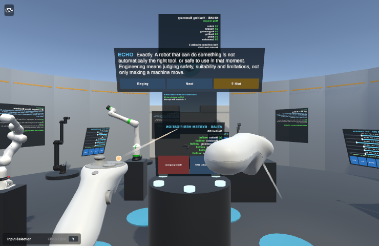

---

## Robots: SimReady to Blender to Unity
30 SimReady USD robots were downloaded from the vendors' Hugging Face datasets. `Tools/Blender/rig_simready.py` builds a bone per physics joint (bone Y = joint axis), rigid-binds each link and exports FBX plus a joint-limits JSON file.

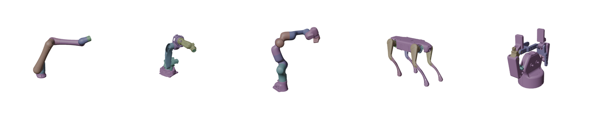
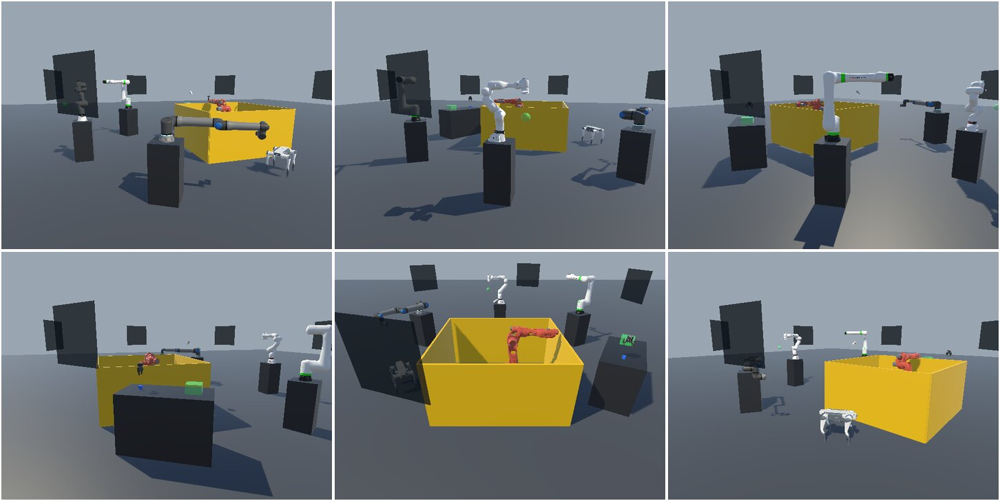

The **Robot Gallery** shows 24 more robots with manufacturer spec plaques, from `Assets/Robotics/Data/robot_specs.json`.

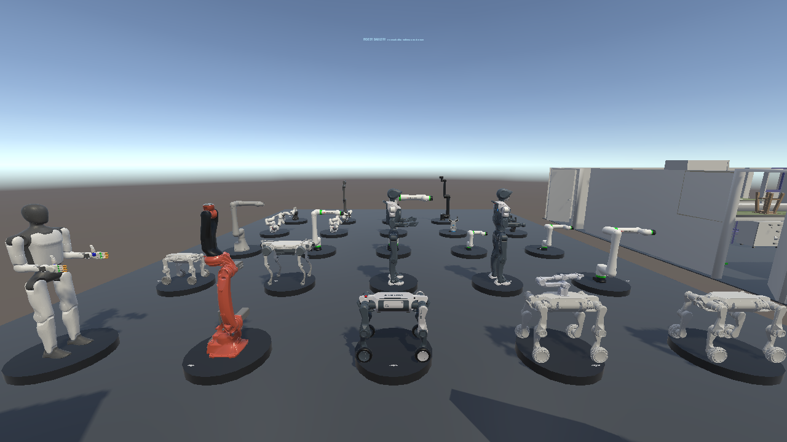

---

## Environment
Two supplied FBX models were cleaned in Blender: missing textures replaced, people and logos removed, and the meshes decimated for Quest. They became the **ATLAS lobby** and the **research lab**.

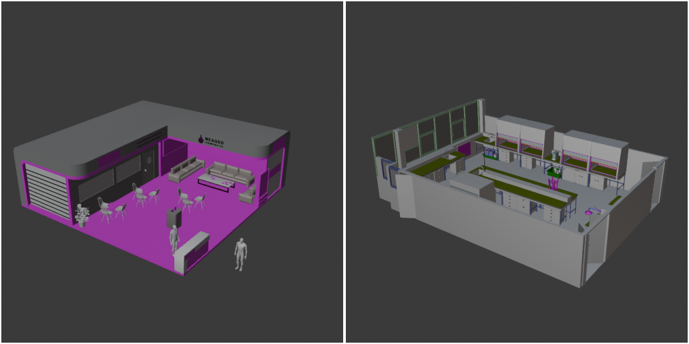

**Facility shell** (`LabFacility.cs`): the original layout left the lobby, hall, gallery and lab floating apart (below). They are now enclosed in one building, with perimeter walls and trim, an annex for the research lab, a roof with an open atrium over the verification hall, and an exterior ground slab.

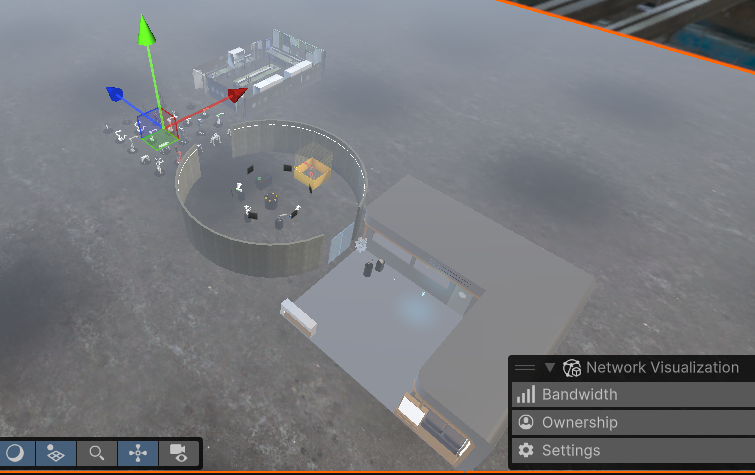

---

## UI: Meta UI Kit
Every panel (pendants, boards, ECHO captions, hub, assessment, clipboard) is built from the **Meta Interaction SDK UI Set** (Quest Dark theme), driven by XRI rays. The supplied **clipboard** model is a grabbable, live trainee checklist.

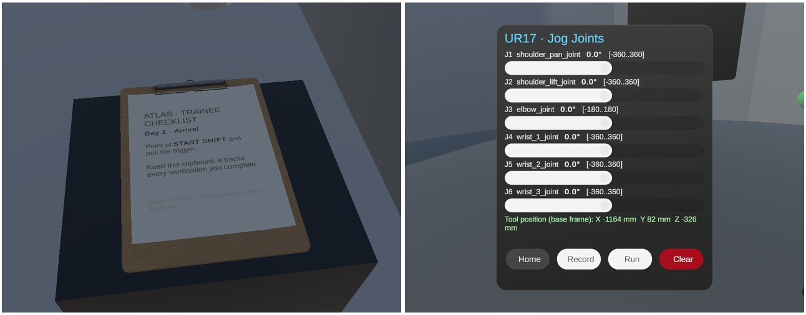

---

## Look: shaders, lighting and baked GI
- **Poly Haven CC0:** workshop HDRI sky; concrete, plaster and metal PBR materials.
- **Custom URP shaders** (Quest-safe): `Hologram` (ECHO), `EnergyField` (targets and light curtain), `PulseGlow` (pads and lamps).
- **Post-processing** (LDR-tuned) and box-projected reflection probes.

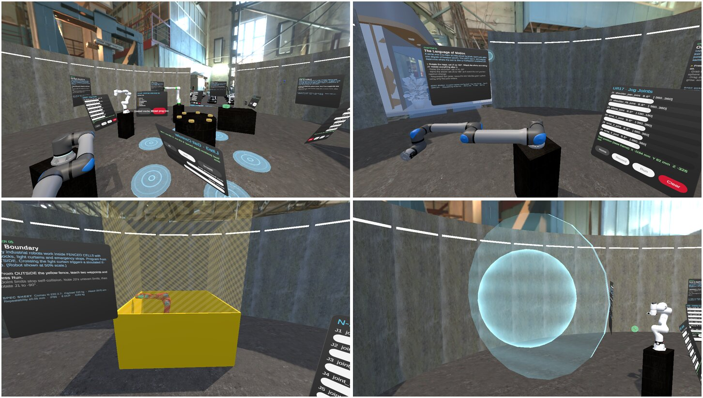

- **Baked GI:** lightmaps with 3 bounces and AO, a shadowmask, 14+ soft area lights and 441 light probes.

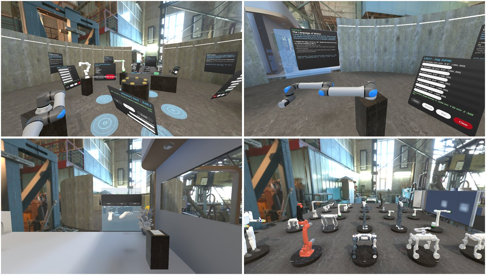
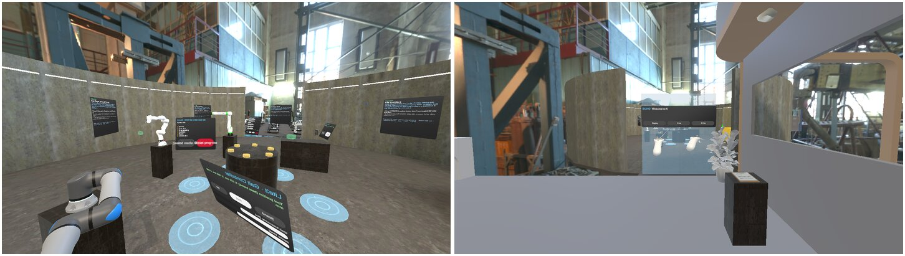

---

## Packages used
| Package | How it's used |
|---|---|
| XR Interaction Toolkit 3.6 | Rays, grabbing, teleport, XR Interaction Simulator |
| Meta Interaction SDK 209 (UI Set) | All UI components and the Quest theme |
| **Timeline** | `Finale_DemonstrationReady.playable`: a facility hologram rises and spins above the hub at DEMONSTRATION READY |
| **Animation Rigging** | Gallery humanoids (AgiBot A3, DR02 Pro, Asimov 1) turn their heads toward the learner (`MultiAimConstraint` + `HeadTracking`) |
| **DOTween** 1.3.045 (`Assets/Plugins/Demigiant`) | Eased lab-door slide with an unlock nudge, hub lamp and lesson board "punch" on completion, ECHO caption pop-in |
| **Obi Rope**: *not installed* | A paid Asset Store product with no free or package-manager version. `VerletCable` (free, Verlet physics) is used instead for the teach-pendant cables to each controller cabinet. Swap in Obi Rope once you own it |
| AI Navigation, Unity Behavior, Yarn Spinner, Meta XR Audio | Installed, ready for NPCs, dialogue and spatial audio |

---

## Folder structure
```
Assets/Robotics/
  Art/       Models · Environment · Props · Materials · Shaders · Textures/PolyHaven
  Code/      Runtime/{Robots, Lessons, Story, UI, XR} · Editor
  Data/      robot_specs.json · usd_physical_data.json
  Resources/ Scenes/ Settings/ Timelines/
Assets/Plugins/Demigiant/DOTween
SourceAssets/   SimReady USDs + .blend working files
Tools/Blender/  rigging, environment cleanup and data-extraction scripts
Docs/Images/    screenshots used in this README
```

## Credits and licenses
- Robots: NVIDIA SimReady / vendor datasets on Hugging Face (see each package's LICENSE).
- HDRI and textures: Poly Haven, CC0.
- DOTween: Demigiant, free version.
- Meta Interaction SDK: Oculus SDK License.
